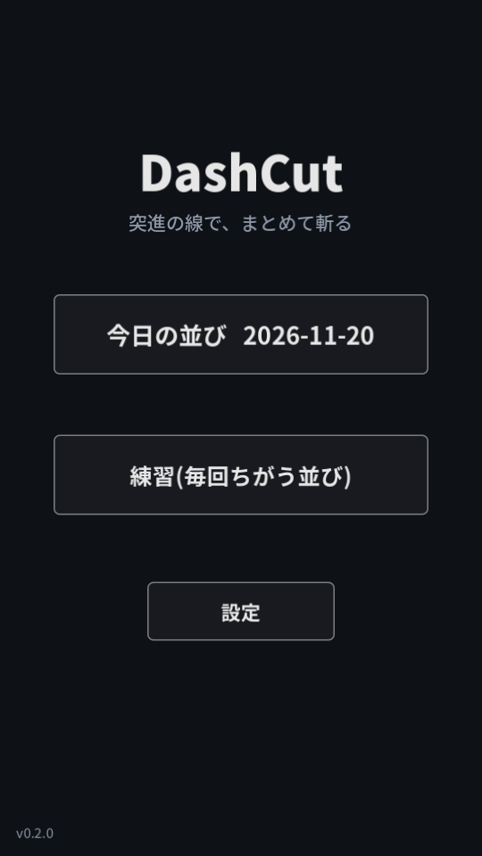
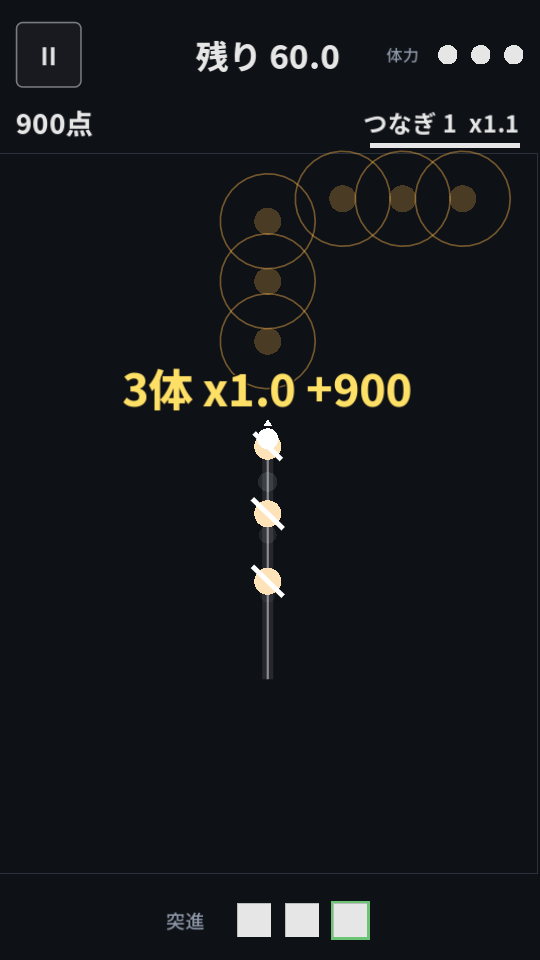
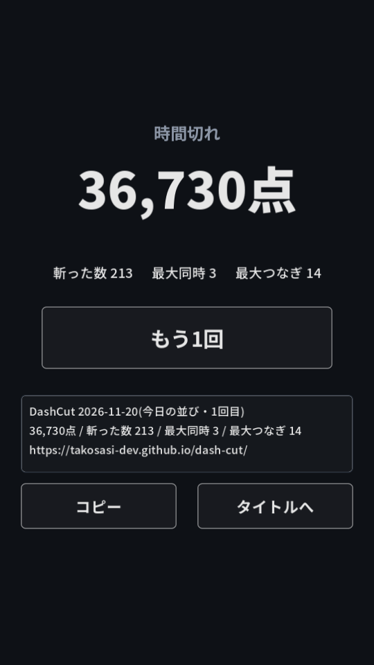

# DashCut

画面を払って突進し、**突進の線の上にいる敵をまとめて斬る**、1 回 60 秒のスコアアタックです。動く手段は突進だけ。1 体以上を斬った突進は使った回数が戻るので、外さない限り止まらずに動けます。ブラウザで開くだけで遊べます。

**▶ 遊ぶ: https://takosasi-dev.github.io/dash-cut/** (デスクトップの Chrome・Edge・Firefox。マウスかキーボードで遊びます。インストール不要)

<p>



</p>

> v0.2.0。突進の距離・止めの長さなどの調整値は、まだ人に遊んでもらって決めた値ではありません。

## 遊び方

- 画面のどこかを**押して、動かして、離す**と、その向きに決まった距離だけ突進します。押している間は通り道の点線と止まる所の輪、斬れる敵の白い縁取りが出ます。
- 通り道に触れた敵は斬れます。斬った敵は突進の終わりに一瞬止まって白く光り、まとめて割れます。3 体以上なら場が光って揺れます。
- 突進は回数制(最大 3 回分、下の四角)。1 秒で 1 回分戻ります。**1 体以上を斬った突進は、使った 1 回分がその場で戻ります**(戻った四角が緑に光ります)。
- 敵は 3 種類。形で見分けます。
  - 丸: 動かない
  - 三角: 寄ってくる。触れると体力 −1
  - 四角: 縁が白く光った後、弾(ひし形)を撃つ。弾は斬れない。突進している間はくぐれる
- 体力は 3。当たると 0.8 秒は当たりません。突進している間は当たりません。
- 時計は**最初に敵を斬った時から**進みます。残り 0 か体力 0 で終わりです。
- 点 = 10 × 斬った数の 2 乗 × つなぎの倍率(x1.0〜x3.0)。外さずにつなぐほど倍率が上がり、外すか当たるか 3 秒斬らないと切れます。つなぎの下の棒が、切れるまでの残りです。
- キーボードでも遊べます: 矢印キー(同時押しで斜め)で向き、スペースで突進、Esc で一時停止。タイトルの Enter で今日の並び、結果の Enter・R でもう1回。

## 今日の並び

「今日の並び」は日付で決まり、同じ日なら誰でも同じ並びが同じ順に出ます。結果画面の文字をコピーして貼れば比べられます。「練習」は毎回ちがう並びです。

```
DashCut 2026-11-19(今日の並び・1回目)
12,400点 / 斬った数 58 / 最大同時 5 / 最大つなぎ 14
https://takosasi-dev.github.io/dash-cut/
```

## しくみ

- **ゲームの決まりは `core/` にだけ**あります(突進・斬る判定・敵と弾・当たり・点・並びの順)。画面は `sim.snapshot()` と `sim.events()` を読んで描くだけです。狙いの線と本番の斬る判定は同じ関数を使います。
- 1/120 秒刻みで進め、入力は払った向きの整数 2 つだけを受けます。同じ種と同じ入力なら同じ結果になることをテストで確かめています(固定の入力の結果を Windows と Linux(CI)で照らす)。
- 敵の並びは手で作った 24 個。どの並びにも、1 回の突進で 3 体以上を斬れる線があることをテストで確かめています。
- 保存はブラウザの中(localStorage の `dash-cut/save`)だけです。サーバーとの通信やアクセス解析はありません。

## 動作環境

- Godot 4.7.2-stable(GDScript、レンダラー Compatibility)
- Web 書き出しはスレッド無し・拡張無し
- スマホのブラウザは保証していません

## 開発

```
# テスト(全件成功で終了コード 0)
godot --headless --import
godot --headless --script res://tests/run_tests.gd

# Web 書き出し(書き出しテンプレート 4.7.2 が要る)
godot --headless --export-release "Web" build/web/index.html

# 同じことを Python から(窓を出さない。Godot の場所は環境変数 GODOT)
python tools/gd.py test
python tools/gd.py export
python tools/gd.py smoke   # 本体を窓なしで動かし、タイトル → プレイ → 結果 → もう1回 を自動で通す
python tools/gd.py perf    # 敵 40・弾 30・破片 240 で 3600 フレーム回し、1 フレームの時間を出す

# ブラウザでの確かめ(Node 22 以上と Chrome。窓なし・消音・使い捨てのプロフィールで開き、本物のマウス・キー・タッチを送る)
node tests/web/check.mjs   # タイトル → プレイ → 結果 → もう1回・キー・タッチ・タブが裏で一時停止・保存・コピー・3 分間の通信 0 件
node tests/web/shots.mjs   # 全部の画面を build/web_shots/ に撮る(--docs で README の画像を docs/ に写す)

# 字体を画面の文字に絞る・効果音を作る(Python)
pip install fonttools
python tools/subset_font.py
python tools/gen_sfx.py
```

`main` に push すると、GitHub Actions がテスト → Web 書き出し → GitHub Pages への配置を行います(`.github/workflows/pages.yml`)。

## 開発状況

- v0.2.0。仕様の画面と決まりは全部入っています。テスト 69 件(Windows と Actions)、窓なしの自動の確かめ(タイトル → プレイ → 結果 → もう1回)は通っています。
- **窓なしの Chrome で、起動と一通りの流れを確かめました**(手元の書き出しと公開 URL。マウスだけで タイトル → プレイ → 結果 → もう1回、矢印とスペースの突進、タッチの払い(Chrome のタッチの模擬)、タブが裏で一時停止、保存が残る、コピー、読み込み後 3 分間の通信 0 件、コンソールのエラー 0 件)。
- まだ確かめていないこと: 人が遊ぶ確かめ・本物のキーボードとマウス・実機のスマホのタッチ・Edge と Firefox・音を耳で聞く確かめ・本物の GPU での入力の遅れ。
- 遊び続けたくなるか(撤退基準 R-1)、入力から動き出しまでの遅れ(R-2)、遊んだ人の説明(R-3)はまだ判定していません。

## ライセンス

MIT(`LICENSE`)。同梱の字体は SIL Open Font License 1.1 です(`THIRD-PARTY-NOTICES.md`)。
